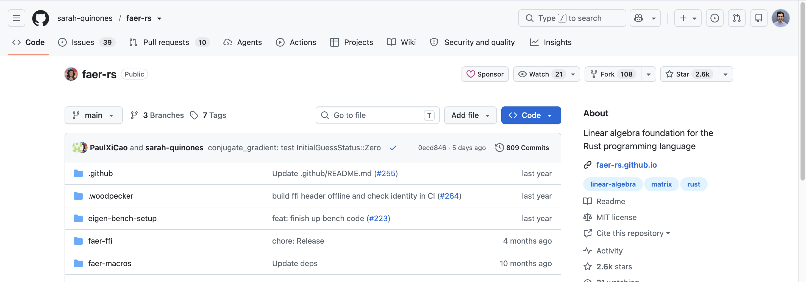
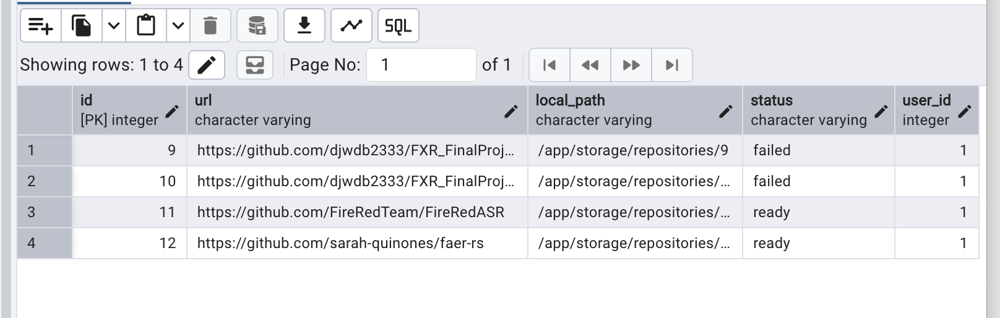
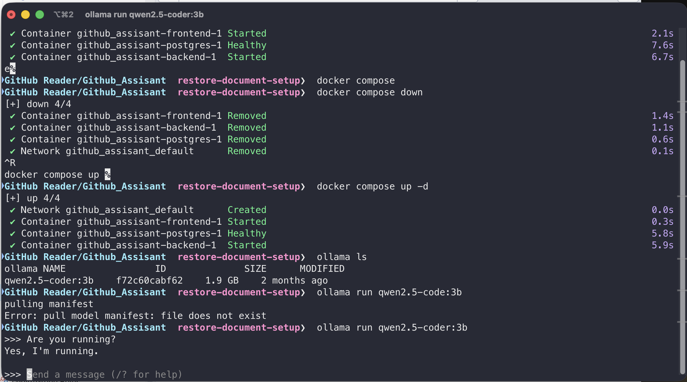
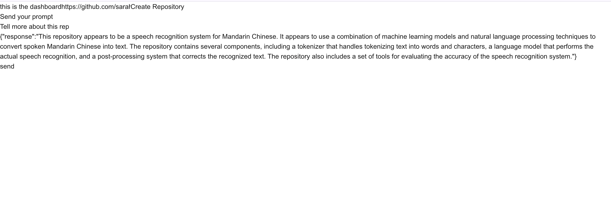
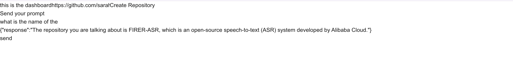
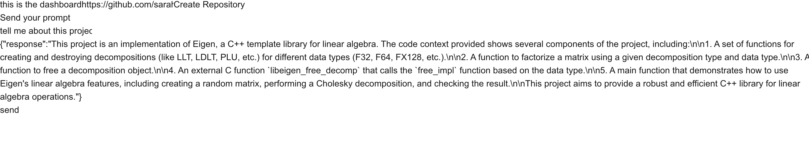

- Account used here: dani, with simple pass ( No Strong Password Checking or anything )
- Added local enviroments and made sure all the env files are ignored when pushed to git

---

Imported the random repository from github ()

The repositories inside PGAdmin:

Asked first question, to know what is this repository about?

- First made sure that the qwen model is running:
  

- Then asked question to learn more about the repo:
  -- The quesition: "Tell more about this repo in one pargraph":
  

==> The resposne seems to be wrong and related to another repository
===> So I asked the model "what is the name of the repoistory are you talking about?" and it's still talking about the previous repository I have added, not the new one

X => There is error with the program, it sticks to the old repository and it doesn't respond to the new added one ( When I removed everything from tables and retried it seemed to work on the new added repo)

( ) Also Here i should note that I need to have an option to choose between repositories that have been already chunked and user can move between them
( ) Also when you create new repos, it doesn't avoid duplicates and if you click on create repo multiple times, it will create everytime without saying we have it before
( ) Chunker seems to have some limited options for file types, it should be able to process much larger file types
